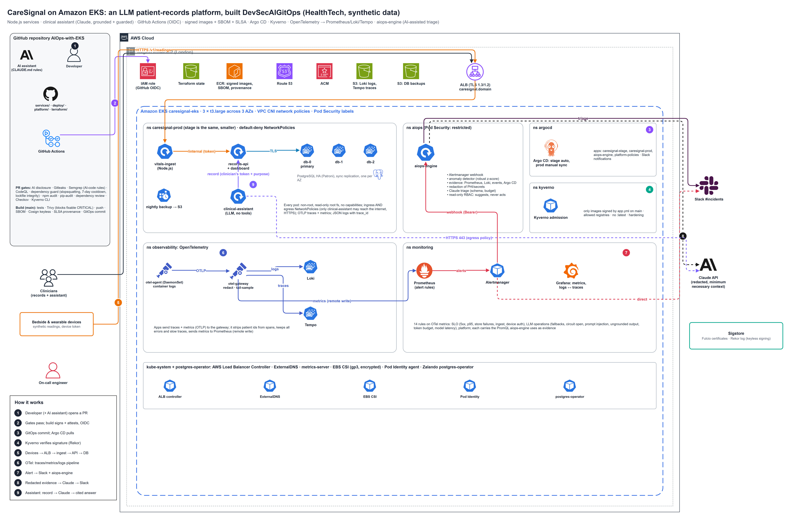

# CareSignal: an LLM patient-records platform on Amazon EKS (HealthTech, DevSecAIGitOps)

Clinicians keep each patient's record (problems, medications, allergies, notes, vital signs from bedside monitors) and use a **clinical assistant built on Claude** to summarise it, ask questions about it and draft discharge summaries and handovers. Every answer cites the record items it comes from; ungrounded answers are withheld; the assistant only writes **drafts that a clinician signs**. Synthetic data only; not a medical device.

The services are **JavaScript (Node.js 24)**. The platform demonstrates **DevSecAIGitOps**:
- AI-assisted development with guardrails;
- a signed software supply chain;
- OpenTelemetry including GenAI spans;
- LLM-ops and AIOps with Claude;
- GitOps with Argo CD, and alerts to Slack.



| Guide | Contents |
|---|---|
| [docs/CareSignal-DevSecAIGitOps-Design-Guide.docx](docs/CareSignal-DevSecAIGitOps-Design-Guide.docx) | The clinical assistant (request path, grounding, human in the loop), principles, AI code security, supply chain, OpenTelemetry and LLM observability, AIOps, HealthTech controls, interview points |
| [docs/CareSignal-Deployment-and-Operations-Guide.docx](docs/CareSignal-Deployment-and-Operations-Guide.docx) | Bootstrap, GitHub settings, deployment, using the assistant, LLM-ops and AIOps demos, operations, troubleshooting, cost |
| [architecture/](architecture/) | Architecture, clinical-assistant request flow, DevSecAIGitOps pipeline, AIOps incident flow (`.drawio` + PNG) |

## What is in the repository

```text
services/
  vitals-ingest/       Node.js: device readings -> NEWS2 early-warning score -> records-api
  records-api/         Node.js: the patient record (PostgreSQL), audit with purpose, AI drafts + clinician sign-off,
                       AI-interaction log, clinicians' dashboard (public/, strict CSP, textContent only)
  clinical-assistant/  Node.js + Anthropic SDK: summary / ask / draft; question guard, minimum-necessary context,
                       Zod structured output, citation check, safety flags, token budget, circuit breaker, fallback
  aiops-engine/        Python (platform): Alertmanager webhook, anomaly detector, evidence, redaction, Claude triage -> Slack
deploy/helm/
  caresignal/          Deployments, HA PostgreSQL, backups, ingress, ingress+egress NetworkPolicies,
                       14 alert rules (SLO, clinical, LLM operations), Grafana dashboard
  aiops-engine/        read-only RBAC, ServiceMonitor, NetworkPolicy
platform/policies/     Kyverno: verify Cosign signatures + SBOM attestation; registries, tags, hardening
terraform/             VPC, EKS, ECR, add-ons, monitoring, OpenTelemetry/Loki/Tempo, Kyverno, Argo CD, app secrets
.github/workflows/     infra · app (test/build/scan/sign/attest/GitOps) · promote · security · ai-governance · scorecard
.semgrep/              AI-code rules (JS + Python) + their self-tests
scripts/               dependency guard (npm + PyPI), AI provenance check, Pod renderer, simulator (patients, records, devices, assistant)
CLAUDE.md              rules for AI coding assistants (also .github/copilot-instructions.md)
```

## Controls at a glance

| Area | Controls |
|---|---|
| LLM safety (OWASP LLM Top 10) | question guard (injection, scope, credential probing) · one patient, no identifiers, escaped `<record>` · structured output (Zod) · citations validated, ungrounded output withheld · deterministic safety flags + rule-based fallback · no tools, drafts only, clinician signs · rate limit, token budget, circuit breaker |
| Privacy | audit of every read with purpose · AI-interaction metadata in the record · no prompts/answers in logs, traces or metrics · egress only for the assistant |
| AI-assisted development | `CLAUDE.md` rules · disclosure + trailers checked · tests required · strict AI-code Semgrep rules · CODEOWNERS |
| AI code security | 22 Semgrep rules (eval, shell, SQL strings, TLS off, `===` on secrets, HTML sinks, PHI/prompts in logs, LLM output reaching eval/fetch/SQL/HTML, literal keys) · CodeQL (JS, Python, Actions) |
| Supply chain | exact npm pins + lockfile integrity · `npm ci --ignore-scripts` · 7-day release cooldown · dependency guard (hallucinated / <30 days / unapproved) · npm audit · pip-audit · SHA-pinned actions · digest-pinned distroless images · Trivy · SBOM · Cosign keyless · SLSA · Kyverno `verifyImages` |
| DAST (OWASP ZAP) | full scan (passive + active, authenticated, OpenAPI-driven) of an ephemeral stack on every PR · baseline of stage nightly and **before every production promotion** · gate with reviewed, expiring exceptions · SARIF to the Security tab (`dast/`, `dast.yml`) |
| Observability | OpenTelemetry Node SDK (HTTP, Express, pg, fetch, pino) + GenAI span `chat claude-opus-5-5` (metadata only) · `caresignal_llm_*` metrics · Tempo, Prometheus, Loki · Grafana LLM-operations row |
| AIOps | 14 alerts incl. assistant degraded, circuit open, prompt-injection attempts, ungrounded output, token budget, model latency · anomaly detection on 6 SLIs · Claude triage with LLM runbooks · Slack |
| GitOps | Argo CD: stage auto-sync, prod manual sync after approval · rollback = `git revert` |

## Run the tests locally

```bash
for s in vitals-ingest records-api clinical-assistant; do (cd services/$s && npm ci && npm test); done   # 11 + 10 + 23
(cd services/aiops-engine && pip install --require-hashes -r requirements.txt && pip install -r requirements-dev.in && python -m pytest -q)  # 34
python -m pytest -q scripts/tests                                                                      # 22
python -m pytest -q dast/tests                                                                         # 12 (DAST gate)
semgrep --test --config .semgrep/ai-code-rules.yml .semgrep/ai-code-rules.js
semgrep --test --config .semgrep/ai-code-rules.yml .semgrep/ai-code-rules.py
python scripts/dependency_guard.py                                                                     # npm + PyPI registries
```

Run locally without a cluster: `records-api` needs PostgreSQL (`DB_HOST`, `DB_USER`, `DB_PASSWORD`, `DB_SSLMODE=disable`); `clinical-assistant` uses the rule-based fallback until `ANTHROPIC_API_KEY` is set; set `OTEL_SDK_DISABLED=true` if no collector is running.

## Deploy

1. `cd terraform && ./create-remote-state.sh` (state bucket, GitHub OIDC role, certificate).
2. GitHub: secrets `AWS_ROLE_ARN`, `ALERT_SLACK_WEBHOOK_URL`, optional `ANTHROPIC_API_KEY` (aiops-engine) and `ASSISTANT_ANTHROPIC_API_KEY` (clinical assistant); environments `infrastructure`, `production`, `stage`; branch protection with Code Owners; label `ai-assisted`; *Settings > Actions > General*: tick **Allow GitHub Actions to create and approve pull requests** (the pipelines deliver their GitOps changes as pull requests, because `main` is protected).
3. Actions: **CareSignal Infrastructure → apply**, then **CareSignal Application → Run workflow** (it opens a pull
   request with the new stage tags: **merge it** to deploy stage), then **CareSignal Promote to Production** (another
   pull request: merge it) and Sync `caresignal-prod` in Argo CD.
4. `python scripts/simulate_devices.py ...` creates synthetic patients and records; open the dashboard and try the assistant.

Cost: about $340/month while running, plus model usage (bounded by the assistant's token budget). Destroy with **CareSignal Infrastructure → destroy**.
